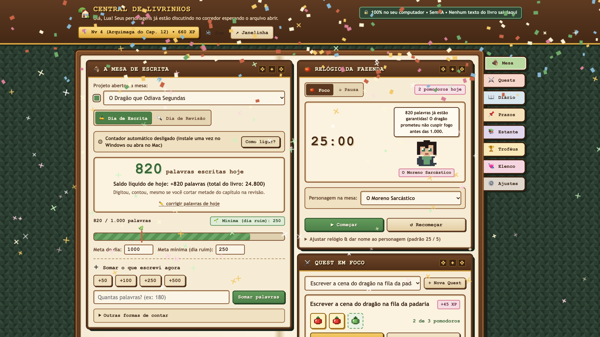

# 🍅 Central de Livrinhos

Uma fazendinha cozy pra quem escreve livros. Contador de palavras automático, pomodoro com tomatinhos, quests, diário, prazos, troféus e um elenco de personagens de romance torcendo por você.

**Grátis pra sempre. Sem IA. Sem internet. Sem conta. O seu texto nunca sai do seu computador.**

Feita por [Raquel Figueiredo](https://raquelverso.com.br), autora de romances. Baixe a versão mais nova pelo site **[raquelverso.com.br](https://raquelverso.com.br)** ou direto aqui: [Mac](downloads/Central-de-Livrinhos-Mac.zip) · Windows: chegando em breve 🍅

---

## O que tem dentro

- **A Mesa:** palavras escritas hoje, meta do dia e meta mínima pra dia ruim. Dia de Escrita, Dia de Revisão ou Dia Misto.
- **Contador automático:** conta sozinho no Word (Windows e Mac) e no Pages (Mac), só nos arquivos que você marcar.
- **Relógio da Fazenda:** pomodoro com tomatinhos, botão de pular a pausa e som ambiente (chuva, lareira, ruído branco e marrom).
- **Quests:** missões P, M e G, cada uma com versão menor pra dia difícil.
- **Diário, Prazos e Estante** dos seus livros.
- **Troféus e Elenco:** medalhas que chegam em cartinha lacrada e desbloqueiam personagens (mocinhos, mocinhas e personagens não binários), cada um com seu jeito de comemorar.
- **Minijogos na pausa**, que fecham sozinhos quando a pausa acaba.
- **Janelinha** pequena que fica por cima do editor de texto.

## Privacidade, explicada pra quem não programa

**O que a Central faz:** pergunta pro Word ou pro Pages "quantas palavras tem esse documento?" e recebe só um número.

**O que ela NUNCA faz:**
- Nunca guarda o seu texto, nem pedaços dele.
- Nunca manda nada pra internet. Ela nem tem como: não existe nenhuma conexão com a internet no código.
- Nunca usa inteligência artificial.
- Nunca lê documentos que você não marcou na Estante.

**O que ela guarda, só no seu computador:** os números (palavras, pomodoros, troféus), as suas quests e diário, e os *nomes* dos arquivos que você marcou na Estante (é assim que ela sabe quais documentos são livro).

**Como conferir você mesma:** desligue o Wi-Fi e use a Central normalmente. Tudo continua funcionando. E o código está todo aqui, aberto, pra quem quiser olhar. A parte que conta palavras fica em `mac/ContarPalavras.m` e `windows/ContarPalavras.cs`, com comentários em português.

**Usa Google Docs?** A contagem automática não funciona com ele, porque o Docs mora na internet e a Central, de propósito, não. É só digitar o total no fim da sessão.

> A IA ajudou só a montar o código desta Central.

## Como instalar

**Windows (chegando em breve):** baixe o pacote do Windows no site, descompacte e dê dois cliques em `Instalar Central de Livrinhos (Windows).bat`. Se aparecer a tela azul "O Windows protegeu o computador", clique em **Mais informações** e depois em **Executar assim mesmo**. Isso aparece porque a Central é feita por uma pessoa, não por uma empresa com certificado pago.

**Mac:** baixe o pacote do Mac no site, descompacte e arraste a `Central de Livrinhos.app` pra pasta Aplicativos. Na primeira vez, se o Mac disser que não pode verificar o app, abra **Ajustes do Sistema → Privacidade e Segurança** e clique em **Abrir Mesmo Assim**.

Depois disso, a Central fica no tomatinho 🍅 perto do relógio.

## Licença

**Creative Commons Atribuição-NãoComercial-CompartilhaIgual 4.0 (CC BY-NC-SA 4.0).**

Em português simples: pode usar, estudar e até fazer a sua versão, desde que dê o crédito à autora original, **não venda** e mantenha as mesmas regras. Se alguém estiver te vendendo isto, você está sendo enganada: a original é de graça.

Texto completo: [creativecommons.org/licenses/by-nc-sa/4.0/deed.pt-br](https://creativecommons.org/licenses/by-nc-sa/4.0/deed.pt-br)
